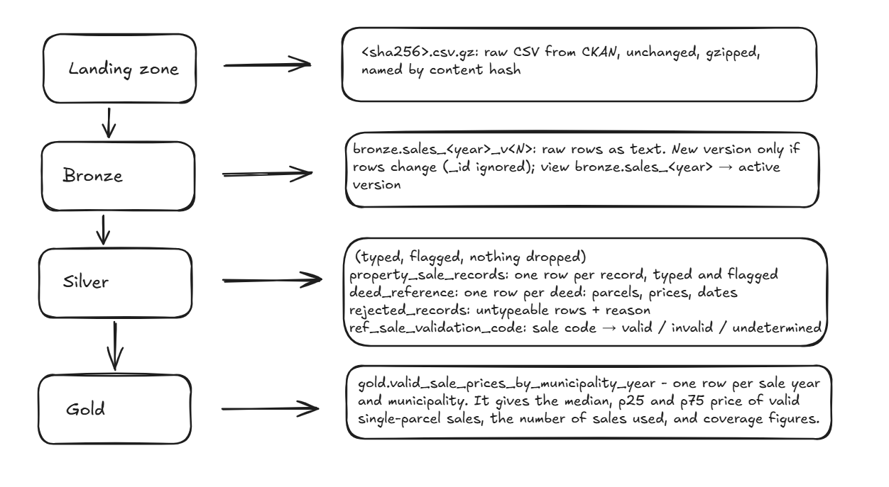

# Allegheny County property sales pipeline

This project downloads the **Allegheny County Property Sale Transactions** data from WPRDC, keeps the raw files exactly as downloaded, cleans the data, and builds one output table that answers a question about sale prices.

It runs on a laptop with Python and DuckDB. No cloud accounts are needed.

## Contents

1. [How to run it](#how-to-run-it)
2. [How the layers are designed](#how-the-layers-are-designed)
3. [The output table and the question it answers](#the-output-table-and-the-question-it-answers)
4. [Dashboard](#dashboard)
5. [Re-runs and source updates](#re-runs-and-source-updates)
6. [Data quality checks](#data-quality-checks)
7. [The three most important design decisions](#the-three-most-important-design-decisions)
8. [Daily refreshes and 100x scale](#daily-refreshes-and-100x-scale)
9. [AI disclosure](#ai-disclosure)
10. [What I found from data](#what-i-found-from-data)
11. [Appendix: the `meta.*` tables](#appendix-the-meta-tables)
12. [What each part does](#what-each-part-does)

## How to run it

You need Python 3.11. From the project folder:

```
pip install -r requirements.txt

python -m pipeline.run                  # download all years, then build silver and gold
python -m pipeline.run --skip-ingest    # rebuild silver and gold from the files already downloaded
python -m pipeline.dashboard            # rebuild only the dashboard from the current gold table
python -m pytest -q                     # run the tests (no download needed)
```

Everything is written to `data/`: the raw files go to `data/landing/` and the tables to `data/warehouse.duckdb`. Every run ends by rewriting the dashboard, `dashboard/home_sale_prices.html` (open it in a browser), and the gold table as `dashboard/valid_sale_prices_by_municipality_year.csv`.

## How the layers are designed

The data moves through four layers: landing → bronze → silver → gold. Each layer is rebuilt from the one before it, so I can always go back to the raw files.



## The output table and the question it answers

**Question:** what is the typical price paid for a property in each municipality, each year, counting only sales the County codes as valid, of a single parcel?

### What the table shows

The queries are in `pipeline/insights.py`, and their full results and a chart for each are in `notebooks/04_output_table.ipynb`. The [dashboard](#dashboard) uses the same queries. The numbers below are **as of data through October 22, 2026**; the dashboard is rebuilt with every refresh and shows the current values.

**How I compared**
- One row of the table = one municipality in one year, with the median price of its valid sales. The County's municipality code splits Pittsburgh and McKeesport into wards, so here "municipality" means a municipality or one of those wards.
- A median from a handful of sales jumps around, so I only compare rows with at least 30 valid sales. That leaves 53–89 municipalities per year (26 in 2012).
- Typical median = the median of those municipalities' medians, i.e. the price in a middle-of-the-road municipality.
- Yearly change is measured inside each municipality (this year's median ÷ last year's), then I take the median of those changes. The set of municipalities with 30+ sales changes every year; if cheap places drop out, prices would look higher even though nothing changed. Measuring per municipality avoids that.

**What it showed**
- **Prices rose slowly until 2019 (1.12x in total from 2013, about 2% a year, though some years were +6–8%), jumped 24% in 2020 and 12% in 2021, and have grown 4–8% a year since (2022–2025).** In 2020, 98% of municipalities went up, so it wasn't a few outliers.
- **Every place went up after 2019.** I followed the same 53 municipalities that have 30+ sales in 2013, 2019 and 2025. The typical one grew 1.12x from 2013 to 2019 and 1.72x from 2019 to 2025, and all 53 were higher in 2025 than in 2019.
- **Cheaper places went up the most.** I sorted municipalities into four groups by their 2019 price. By 2025 the cheapest group had grown 2.15x and the most expensive 1.46x. Most of this happened in 2020–2021.
- **Expensive places stay expensive, but the gap is shrinking.** The ranking barely changes from year to year. But the 90th-percentile municipality cost 3.2–4.0x the 10th up to 2019, 3.0–3.1x in 2020–2022, and 2.6–2.85x from 2023.
- **Highest and lowest in 2025** (30+ sales): Fox Chapel $977,000, Pine $675,000, Marshall $579,125 at the top; Port Vue $123,500, Stowe $136,750, North Versailles $149,900 at the bottom.
- **One municipality as an example:** Penn Hills (the most valid sales of any municipality code; Pittsburgh as a whole would have more, but it is split into wards) was $78,000–85,250 from 2012 to 2019, $112,000 in 2020 and $184,250 in 2025.

**What to keep in mind**
- **2012 isn't reliable as a starting point:** only 7.7% of its records are coded valid, and only 26 municipalities have 30+ sales.
- **2019 is the next weakest year** (12.8% coded valid, 53 municipalities with 30+ sales), and it's the base year for "every place went up after 2019" and "cheaper places went up the most". Those hold for the 53 places that can be measured, but they're based on fewer sales than the years around them.
- **2026 isn't finished,** and its sale codes are still being reviewed, so comparisons stop at 2025.
- **There's no property type in the data.** If more condos sold one year, the median could drop without prices actually falling.


### Output table: `gold.valid_sale_prices_by_municipality_year`

One row per year and municipality: 2,618 rows, 175 municipality codes (Pittsburgh and McKeesport split into wards), 15 years. Together the rows cover all 506,977 records (`records_total` adds up to that).

| Column | Meaning |
|---|---|
| `sale_year`, `muni_code`, `muni_desc` | the year and the municipality |
| `valid_sales_used` | how many sales the prices are based on |
| `median_price`, `p25_price`, `p75_price` | the typical price, and the range of the middle half of prices. Empty when there are fewer than 5 sales |
| `records_total`, `records_valid`, `records_undetermined` | all records, the ones coded valid, and the ones the County hasn't reviewed yet (`AA`) |
| `pct_valid`, `pct_undetermined` | the same as percentages, to show how much of the year the numbers are based on |
| `valid_records_excluded` | valid-coded records that couldn't be used (see below) |
| `is_low_sample` | fewer than 10 sales |
| `is_partial_year`, `is_provisional` | the latest year: not finished yet, and its sale codes are still being reviewed |

**Which records count as a sale**
Valid sale code (`0`, `U`, `UR`) → has a price → its deed covers one parcel on one sale date → the parcel isn't also on another deed on the same date → used.
114,611 valid-coded records → 114,313 used + 298 excluded. A hard check makes sure these always add up.

## Dashboard

`dashboard/home_sale_prices.html` is a single page for people who use the County's data rather than the code. It's laid out like the dashboards on [Allegheny Analytics](https://analytics.alleghenycounty.us/) (for example their Juvenile Justice Offenses dashboard: Home / Data and Definitions / Summary / Neighborhood), and its Municipality tab works like their Human Services Community Profile (pick a place and compare it with up to five others).

| Tab | What it shows |
|---|---|
| Home | What the page is, the headline numbers for the last complete year, the findings above written out with the current numbers, and a short caveat |
| Data and Definitions | What data is available, what each term means, the limits (2012, 2019, the provisional year, no property type), and how much of each year is coded valid |
| County Summary | Typical yearly change, share of places going up, the spread between expensive and cheap places, growth by price quarter, before/after the jump, and the highest and lowest places for any year |
| Municipality | A map of the typical price by municipality and ward for any year, and a profile of one place compared with up to five others: price with its middle half, sales behind each year, and a year-by-year table with reliability badges |

- **Refreshes with the data.** `pipeline/run.py` rebuilds the page after every successful gold build, so whatever runs the pipeline daily also refreshes the page; it shows "Data through" (the latest sale date) and when it was rebuilt. If the page can't be built, the run still succeeds and the previous page stays.
- **Same numbers as the notebook and this README.** Every chart comes from the queries in `pipeline/insights.py`. Places with fewer than 30 sales are shown but not compared, and the County level (the typical municipality) is shown only for years with at least 50 comparable places, so 2012's $160,625 isn't drawn as a drop.
- **The map** uses the County's voting district outlines from WPRDC, merged into municipalities and the wards of Pittsburgh, McKeesport, Clairton and Duquesne (all 175 codes match). They're downloaded once into `data/boundaries/`; if that fails, the page is built without the map.
- **No server needed.** It's one HTML file with the data inside; charts use Plotly from a CDN. The CSV next to it is the gold table, ready for Tableau, ArcGIS or Excel.

## Re-runs and source updates

On every run, `pipeline/run.py` goes through these steps for each of the 15 year files (`ingest.py`, using `ckan.py` to talk to the API).

**1. Download every year again.** The source also changes past years' files, so I download all years, not only the latest one.

**2. Check the source isn't in the middle of rewriting the file.** I read the file's last-modified time and row count from the API before and after the download. If I've already seen that last-modified time with a different row count, or anything changed during the download → I refuse the file, keep the current version, and try again next run → logged in `run_log` as `failed`.

**3. Save the file to landing, unchanged** → `data/landing/real_estate_sales/<year>/<sha256>.csv.gz`
- The file is named by the SHA-256 of its original bytes (taken before gzip), so the same content always gets the same name and is never stored twice.
- gzip is written with a fixed timestamp, so the same download always gives exactly the same `.csv.gz`.

**4. Compare with the version in use**

| What I find | Result | Meta tables updated |
|---|---|---|
| Same SHA-256 as the version in use | `identical_file` → nothing to do | `run_log` |
| Different SHA-256, same rows (ignoring `_id` and row order) | `republished_same_content` → no new version | `landing_alias`, `run_log` |
| The file or its rows match an older version | `reverted` → switch back to that version | `active_version`, `run_log` |
| The rows really changed | `content_changed` → new bronze version `sales_<year>_v<N+1>`, and the view points to it | `load_manifest`, `active_version`, `change_log`, `diff_*`, `run_log` |

**Example, different file but same rows:** the source re-publishes 2018 with exactly the same sales, but every row gets a new `_id`. The bytes change → new SHA-256 → but the rows are the same → no new version. The file is remembered in `landing_alias`, so if it shows up again it's recognised by its SHA-256 without being read again.

**Example, `reverted`:** 2018 is on v1 → the source changes some rows → v2 becomes the version in use → later the source publishes the old content again → it matches v1 → the view `bronze.sales_2018` points back to v1. No new version is created. If v1's table had been dropped to save space (2 versions are kept per year), it's rebuilt from its landing file first.

**5. Rebuild silver and gold** (`silver.py`, `gold.py`, `checks.py`)
Built from the bronze versions in use → into staging tables → checks run → swapped in with one transaction only if no hard check fails → logged in `build_log` and `check_results`. If a hard check fails, the current tables stay as they were. Silver is swapped in before gold is built, so if gold then fails, silver is switched back to the tables it replaced (logged as `rolled_back`); the live silver and gold always come from the same build.

**Result**
- **Running it twice** → nothing new is stored, and silver and gold come out the same (the rebuild is tested in `tests/test_pipeline.py`).
- **The source updates a year** → a new bronze version → silver and gold pick it up in the same run.
- **One year fails** → it keeps its previous version, and the other years carry on.

Why I designed it this way, and what I rejected, is in [the design decisions](#the-three-most-important-design-decisions).

## Data quality checks

Each check is one SQL query in `pipeline/checks.py` that counts the rows failing it. Silver and gold are built into staging tables → the checks run → the tables are swapped in only if no hard check fails. Every result is saved in `meta.check_results`.

| Type | Used for | What happens |
|---|---|---|
| **hard** | the source changed its format (a column renamed, dates in a new format), or my own code is wrong (rows lost, a sale counted twice) | the build stops, the last good silver and gold stay in place, and the run ends with an error |
| **reject** | a single row can't be read (bad parcel id, sale date, price or record date, or a sale date before 2012 or after the file's date) | the row goes to `silver.rejected_records` with the reason, and the build goes on. If more than 0.1% of a year is rejected, it becomes a hard failure |
| **warn** | something changed that a person should look at (a new sale code, a new code format, a year losing more than 5% of its rows) | printed and saved; the build goes on |
| **info** | known problems in the source (placeholder deeds, record date before sale date) | counted on every build; the rows stay in silver with a flag |

I also added standard checks:
- required fields are present
- the sale date is in range
- the row counts add up from bronze to silver
- bronze still has the row count it was loaded with
- every sale code is known
- there's one output row per year and municipality


## The three most important design decisions

### 1. Keep full copies of each year's file, and a new copy only when the rows change

**Why**
The source gives me no way to load only what changed:
- there's no change feed and no "updated at" column
- past years get changed too, and deleted rows aren't reported
- the last-modified time changes every morning even when nothing changed (I saw the files being rebuilt daily)

**What I do**
Download all 15 files on every run → compare with the version in use → save a new bronze version only when the rows really changed (how I tell → decision 2). Every version is a full copy of the year, and silver and gold are always rebuilt from a full version, never patched.

**Why gzip in landing**
- 441 MB raw → 94 MB gzipped (4.7x smaller) for the 61 files kept so far. This matters even more in cloud storage, where every version is kept.
- It's still a plain CSV that any tool can read.
- The SHA-256 is taken before gzip, and gzip uses a fixed timestamp → the same download always gives the same file and name.

**How long things are kept**
- Landing files: forever. They're the record of exactly which file was used and when.
- Bronze tables: the newest versionfix 2,3 per year by default (`--keep-versions`). Older ones can be rebuilt from landing with `python -m pipeline.ingest --restore YEAR:VERSION`.

**Rejected alternatives**
- *Overwrite with the latest download* → I'd lose what changed and when, and a half-written file could replace a good one.
- *Load only what changed* → there's nothing reliable to base it on (no change feed, no updated-at, deletions not reported).
- *Skip the download if last-modified hasn't changed* → it changes every day anyway, so it doesn't tell me anything.
- *Store only the differences instead of full copies* → smaller, but getting a version back means replaying every difference. At this size full copies are simpler.
- *Store raw files uncompressed* → 4.7x more disk for no benefit.

### 2. Detect changes by what's in the rows, not by `_id`

**Why**
The source gives every row an `_id`, but gives every row a new one each time it re-publishes a file, even when nothing changed. So a new file or a new `_id` doesn't mean new data, and `_id` can't identify a row. I keep it only to trace a row back to the file (`source_row_id` in silver), never as a key.

**Two hashes, two questions**

| Hash | Of what | Answers | Why I need it |
|---|---|---|---|
| SHA-256 | the file's original bytes | "is this exactly the same file?" | quick, no need to read the file; also names the landing file |
| Row fingerprint | every row, ignoring `_id` and row order | "is this the same data?" | the bytes change on every re-publish because `_id` changes |

Same SHA-256 → stop. Different SHA-256 → check the row fingerprint → same → no new version. 35 re-publishes were caught this way.

**Rejected alternatives**
- *Match rows by `_id`* → it changes on every re-publish.
- *SHA-256 only* → every re-publish would become a new version (35 versions that aren't real changes).
- *Row fingerprint only* → every download would have to be read in full, and landing files would have no content-based name to avoid storing duplicates.
- *Use parcel + deed + sale date as the row key and update rows in place* → that combination repeats in 90 groups with conflicting rows, so an update would silently keep one of them.

### 3. Silver keeps every source record and flags problems instead of fixing them

**Why**
There's no reliable id for a sale. Parcel + deed + sale date looks like one, but it repeats in 90 groups where the sale code (77 groups) or the price (25 groups) disagree, and only the County can say which row is right.

**What silver does**
- **Types and trims** every row, and keeps it.
- **Flags** known problems: placeholder deed (`0`/`0`), repeated parcel + deed + date, record date before the sale date.
- **Sets aside** only rows that can't be read at all, in `silver.rejected_records` with the reason (0 today).
- **Maps each sale code** to valid / invalid / undetermined using the code, never the description.

**Rejected alternatives**
- *Keep one row per sale* → there's no evidence-based rule for which row to keep.
- *Drop invalid sales in silver* → whether a sale is valid is the County's call, and it changes over time (400 sale codes changed in 3 days), so that filter belongs in gold.
- *Remove leading zeros from deed pages* (`00137` vs `137`) → it would merge only 6 deed numbers, and 4 of those are clearly different sales.
- *Fix data-entry mistakes* (e.g. a record date in the year 212) → guessing the right value would hide the problem. They're kept as written and counted.

## Daily refreshes and 100x scale

- **Rebuild only the years that changed.** Today silver is rebuilt in full on every run, which takes seconds. At 100x I'd split silver by sale year and rebuild only the years whose bronze version changed; bronze already knows which ones those are. I'd still rebuild everything when the sale code lookup or the code changes.
- **Swap one year at a time.** If one year's file breaks, the other years still update, and the broken year keeps its last good version. 
- **Keep the deed table across all years.** The same deed number shows up in different years, so `silver.deed_reference` can't be rebuilt one year at a time.
- **Run after the source's morning rebuild,** e.g. 09:00 ET. The pipeline already refuses a file that's being rewritten and tries again next run.
- **Automating it with Airflow and cloud**
 - **Scheduling:** one Airflow DAG at 09:00 ET with `max_active_runs=1`, so only one run writes at a time. One ingest task per year → silver → gold.
- **Storage:** landing in S3 with versioning on. Bronze, silver and gold as Parquet in S3.
- **Alerts:** a hard failure pages someone; a warning posts to Slack.
- **Packaging:** one Docker image (`python -m pipeline.run`), tested in CI on every push, with settings and secrets from environment variables.


## AI disclosure

I used **Claude Code** as a collaborative partner:
- **Understanding the data:** to understand the dataset and cross-check my own understanding of it.
- **Profiling plan:** I built the profiling steps and the plan together with Claude. I went through the plan it suggested, questioned the parts I wasn't convinced about or had doubts on, and changed them. Then I asked it to implement the plan with a few rules: follow the project's folder structure, reuse common code, and change an existing function instead of writing a new one when one already exists.
- **Checking my analysis:** to check my analysis and explanations against what each query actually returned. In some places it added analysis I hadn't thought of at first.
- **Open questions:** to check whether the official website or documentation had any information on my open questions, and to reason through them. Anything the source doesn't confirm, I left as an open question, since as a data engineer it needs to be confirmed, not assumed.
- **Design:** to think through the design and the check types. This was most useful when one of us suggested a design and we reasoned through what happens when the data grows or runs in production, and debated the alternatives until I reached a solution I found workable.
- **Writing:** to review this README and the notebooks for accuracy, grammar and wording.

## What I found from data

Each row is something I found while exploring the data (notebooks 01–03) and what I did because of it.

| What I found | What I did |
|---|---|
| The data dictionary says dates are dd/mm/yyyy, but every file uses yyyy-mm-dd | Read dates as yyyy-mm-dd |
| `_id` changes on every re-publish (35 times while I built this) | Compare files by row content, not by `_id`; keep `_id` only to trace a row back |
| Files are rebuilt every morning (about 07:00–08:20 ET, going by the source's last-modified times), even when nothing changed; twice I caught a file mid-rewrite | Refuse a file whose row count doesn't match, keep the current version, retry next run |
| Old years still change (2013 gained 181 rows, 2018 gained 378 in late October 2026) | Download all years every run; rebuild silver and gold every run |
| Most records aren't market sales: $1 is the most common price (105,558 of 506,977 records), a quarter of priced records are $10 or less, a few are over $100M | Only sales the County codes as valid; median, not average |
| The share of records coded valid changes by year (7.7% in 2012, 32.2% in 2023) because the coding changed, not the market | Don't compare sale counts across years; show `pct_valid` on every row |
| Sale codes change after publishing (400 in the 2026 file within 3 days) | Filter valid sales in gold, not silver; mark the latest year `is_provisional` |
| Deed `0`/`0` is shared by 957 unrelated parcels | Flag placeholder deeds; never group or join on them |
| A deed with several parcels shows the deed's total price on every parcel (24,408 of 25,170 such deeds) | Only use deeds with one parcel (leaves out 165 valid-coded records, 0.14%) |
| A deed number with several sale dates isn't reliably one sale: days apart in one file, years apart across files | Only use deeds with one sale date |
| 60 parcels have valid records on one sale date under two different deeds: one sale entered twice, or two sales back to back | Use neither price; count both in `valid_records_excluded` |
| 59 valid-coded sales are under $1,000 | Keep them; the sale code decides, not the price |
| Small groups: the median year × municipality row has 21 sales; by quarter it would be 7 | Year × municipality; flag rows under 10 sales; no median under 5 |
| A parcel's address and municipality never change across 15 years (313,906 parcels) | Treat the municipality as probably today's, and say so as a caveat |
| 3,165 records have ZIP codes outside 150xx–152xx for parcels inside Allegheny municipalities | Group by municipality, not ZIP; no county-range check on ZIP |

## Appendix: the `meta.*` tables

| Table | One row = |
|---|---|
| `load_manifest` | one loaded version: landing file, SHA-256, row fingerprint, row count, last-modified time |
| `active_version` | the version in use for each year |
| `landing_alias` | a re-published file with the same rows as an existing version |
| `run_log` | what happened to one year in one run |
| `change_log` | one real change: year, from which version to which, rows added and removed |
| `diff_<year>_v<a>_v<b>` | the exact rows added and removed in that change |
| `build_log` | one silver or gold build: ok or failed, which bronze versions it used |
| `check_results` | one check in one build: how many rows failed, and whether it stopped the build |

## What each part does

| File | What it does |
|---|---|
| `pipeline/ckan.py` | Finds the 15 yearly files (2012–2026) through the CKAN API, and reads each file's last-modified time, row count and columns |
| `pipeline/ingest.py` | Downloads each year into landing. Loads it into bronze as a new version only if its rows really changed. Logs every run in `meta.*` |
| `pipeline/silver.py` | Gives every column its proper type, trims spaces, flags known problems, sets aside rows that can't be read, and builds the deed table. No rows are removed |
| `pipeline/gold.py` | Builds the output table: median, p25 and p75 price of valid single-parcel sales per year and municipality, and how many sales each number is based on |
| `pipeline/checks.py` | The data quality checks. **hard** stops the build, **warn** is reported, **info** is counted. Results go to `meta.check_results` |
| `pipeline/insights.py` | The questions asked of the gold table, as SQL, shared by notebook 04 and the dashboard |
| `pipeline/dashboard.py`, `pipeline/dashboard_template.html` | Writes the dashboard page and the CSV from gold, and builds the map outlines |
| `pipeline/run.py` | Runs ingest → silver → gold → dashboard |
| `notebooks/` | 01–03: exploring the data, which shaped the design and the checks. 04: what the output table shows, with a chart per question |
| `tests/` | Break a small fake dataset on purpose and check that the pipeline stops, rejects or warns as expected |